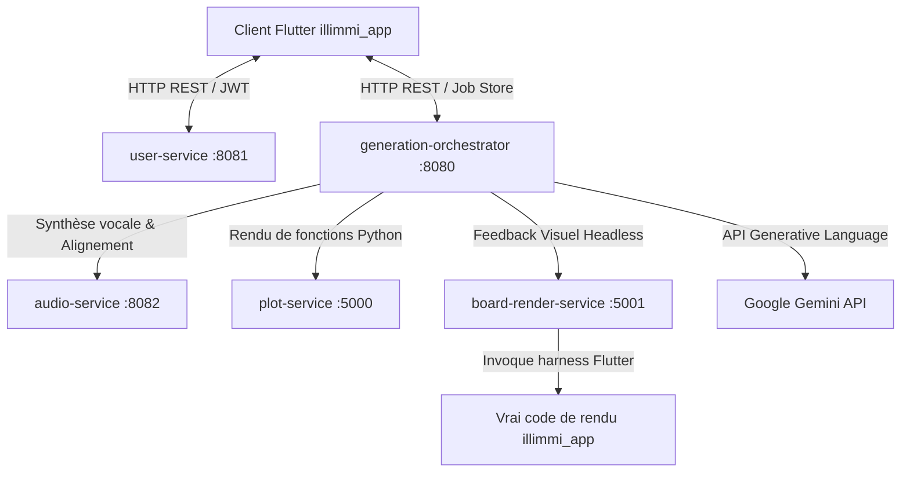
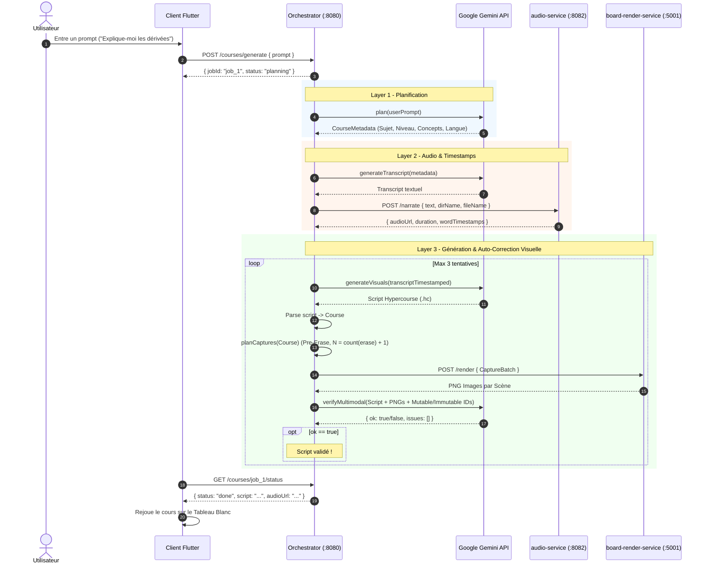

# ILLIMMI — Architecture Technique & Système

> **Plateforme de génération automatique et de rendu déterministe de cours interactifs de mathématiques et de sciences.**

---

## 1. Vue d'ensemble du système

ILLIMMI adopte une **architecture orientée microservices découplée**, séparant la logique d'intelligence artificielle et d'orchestration (génération de scripts et d'audio) du moteur de rendu graphique déterministe (client Flutter).

### Principes architecturaux clés
1. **Génération déterministe par DSL (Hypercourse `.hc`)** : L'IA ne génère jamais de pixels ni de vidéo directement. Elle produit un script textuel structuré décrivant l'affichage, le placement et le tempo.
2. **Double rendu (Front-end & Headless)** : Le moteur de rendu réel (`BoardPainter`, `LatexWidget`, `CoursePlayer`) est réutilisé en mode headless via `board-render-service` pour fournir un retour visuel direct à l'orchestrateur IA.
3. **Persistance découplée** : L'historique et les comptes utilisateurs sont optionnels et gérés indépendamment par `user-service`.

---

## 2. Description des composants

### 2.1 Client Flutter — `illimmi_app`
- **Rôle** : Moteur de rendu principal et lecteur vidéo/audio interactif.
- **Technologies** : Flutter (Windows, Web, Mobile), `CustomPainter`, `flutter_math_fork`.
- **Fonctionnement** :
  - Reçoit un script `.hc` et un fichier `.wav`.
  - Parse le script via `HypercourseParser` et construit l'index temporel (`FamilyForest` / `SegmentNode`).
  - Joue la boucle d'animation (`CoursePlayer`) à 60 FPS en calculant à chaque frame les éléments vivants (`queryAll(currentTime)`).

### 2.2 Orchestrateur de génération — `services/generation-orchestrator`
- **Rôle** : Cerveau du système. Orchestre les 3 Layers du pipeline IA et la boucle d'auto-correction visuelle.
- **Port** : `8080` (Dart HTTP avec `shelf`).
- **Composants internes** :
  - `Layer1Planner` : Analyse le prompt utilisateur et produit le plan pédagogique.
  - `Layer2AudioGenerator` : Génère le transcript et sollicite `audio-service`.
  - `Layer3VisualGenerator` : Génère le script Hypercourse `.hc`.
  - `Layer3VisualVerifier` : Effectue la vérification visuelle multimodale (Gemini).
  - `JobStore` : Gestionnaire de tâches asynchrones en mémoire.

### 2.3 Service Audio & TTS — `services/audio-service`
- **Rôle** : Synthèse vocale de haute qualité et alignement mot-à-mot.
- **Port** : `8082` (Dart / Process natif Windows).
- **Moteur TTS** : Piper TTS natif (`speaker/piper/piper.exe` avec modèle vocal `fr_FR-siwis-medium.onnx`).
- **Alignement** : Calcul des timestamps exacts de chaque mot de la narration.

### 2.4 Service de rendu graphique — `services/plot-service`
- **Rôle** : Génération des graphiques et courbes de fonctions mathématiques interactives.
- **Port** : `5000` (Python / FastAPI).
- **Fonctionnement** : Reçoit des snippets de code Python/Matplotlib/Plotly pour les convertir en rendu HTML/SVG interactif.

### 2.5 Service de capture Headless — `services/board-render-service`
- **Rôle** : Fournir une capture d'écran exacte du tableau blanc à l'orchestrateur.
- **Port** : `5001` (Dart / Flutter headless).
- **Fonctionnement** : Exécute en subprocess un harnais Flutter `integration_test` qui instancie le vrai `BoardPainter` et produit des fichiers PNG neutres.

### 2.6 Service Utilisateur — `services/user-service`
- **Rôle** : Authentification JWT (inscription / connexion) et persistance SQLite de l'historique des cours.
- **Port** : `8081` (Dart HTTP + SQLite).

---

## 3. Flux de données complet (Séquence)

---

## 4. Matrice des Ports & Réseau

| Service | Port local | Protocole | Variable d'environnement |
| :--- | :--- | :--- | :--- |
| `generation-orchestrator` | `8080` | HTTP / JSON | `GENERATION_ORCHESTRATOR_URL` |
| `user-service` | `8081` | HTTP / JSON | `USER_SERVICE_URL` |
| `audio-service` | `8082` | HTTP / WAV | `AUDIO_SERVICE_URL` |
| `plot-service` | `5000` | HTTP / HTML | `PLOT_SERVICE_URL` |
| `board-render-service` | `5001` | HTTP / JSON | `BOARD_RENDER_SERVICE_URL` |
