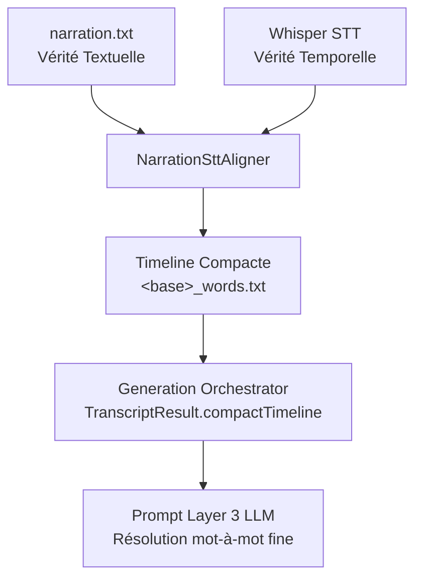

# Alignement Audio & Chronologie Compacte (Compact Timeline)

> **Documentation technique de la nouvelle architecture d'alignement audio mot-à-mot, du format compact `<start>mot<end>` et de son injection directe dans le LLM de Layer 3.**

---

## 1. Contexte & Problématique

Dans les versions initiales du pipeline de génération ILLIMMI :
- L'alignement temporel reposait sur l'export JSON brut de Whisper (`*_words.json`).
- Ce fichier était extrêmement volumineux (**~143 Ko** pour un cours type de 3 minutes).
- **Problèmes textuels de Whisper** :
  - Fragmentation des mots en sous-tokens BPE (`constru` + `ire`).
  - Suppression ou hallucination de la ponctuation et des majuscules.
  - Altération des nombres (ex: transcription en chiffres arabes `3` au lieu de `trois`).
  - Déformations orthographiques sur les termes mathématiques.
- **Perte de précision dans Layer 3** : Pour éviter l'explosion du contexte en tokens LLM, l'orchestrateur regroupait arbitrairement les mots par blocs de 6 (`[0.0s] mot1 mot2...`), détruisant la résolution temporelle fine nécessaire à la synchronisation exacte des animations visuelles.

---

## 2. Le Principe Fondamental : Découplage Texte / Temps

Le système sépare strictement les responsabilités :

| Source | Rôle | Garanties |
| :--- | :--- | :--- |
| **`narration.txt`** | **Source de vérité textuelle** | • Orthographe exacte et vocabulaire mathématique certifié<br>• Ponctuation française complète (virgules, deux-points, etc.)<br>• Majuscules, casse et ordre des mots |
| **Whisper / STT** | **Source de vérité temporelle** | • Détection acoustique des intervalles temporels (`start`, `end`)<br>• Aucun texte Whisper n'est conservé dans le livrable final |



---

## 3. L'Algorithme d'Alignement (`NarrationSttAligner`)

L'algorithme (`services/audio_service/lib/align/narration_stt_aligner.dart`) réalise un appariement monotonique entre les mots de `narration.txt` et les tokens Whisper :

### 3.1 Prétraitement de la ponctuation française (`NarrationParser`)
En français, les ponctuations doubles (`!`, `?`, `:`, `;`) sont précédées d'une espace insécable. Le parser les rattache directement au mot qui les précède (ex: `Bonjour !` $\rightarrow$ un seul jeton `Bonjour !`) afin d'éviter la création artificielle de jetons audio orphelins.

### 3.2 Fusion des sous-mots Whisper
Whisper segmente fréquemment un mot en fragments de phonèmes.
*Exemple* :
- `narration` : `construire`
- `Whisper` : `constru` [3.16s - 3.40s] + `ire` [3.40s - 3.60s]
- *Résolution* : L'aligneur détecte la concaténation et fusionne l'intervalle temporel $\rightarrow$ `construire` [3.16s - 3.60s].

### 3.3 Éclatement des tokens multi-mots STT
À l'inverse, Whisper agglomère parfois deux mots consécutifs en un seul token audio.
*Résolution* : L'aligneur partitionne proportionnellement l'intervalle temporel entre les mots attendus de la narration.

### 3.4 Nombres et chiffres en français
Gestion des équivalences entre écriture littérale et notation chiffrée (ex: `trois` $\leftrightarrow$ `3`, `dix-huit` $\leftrightarrow$ `18`).

### 3.5 Appariement flou (Distance de Levenshtein)
Pour absorber les légères variations de prononciation ou les imperfections de transcription phonétique de Whisper, un matching tolérant est appliqué sur les clés normalisées (suppression d'accents et caractères spéciaux).

### 3.6 Préservation de la monotonicité et des bornes
Chaque mot vérifie $start \le end$ et $start_i \ge start_{i-1}$.

---

## 4. Le Format Compact : `<base>_words.txt`

### 4.1 Spécification
Chaque mot de la narration est consigné sur une ligne distincte selon la syntaxe :
```text
<START>TEXT<END>
```

- `START` et `END` : Horodatages en secondes formatés avec 3 décimales (`0.000`).
- `TEXT` : Mot intégral incluant sa casse et sa ponctuation d'origine.

*Exemple extrait de `vecteurs_words.txt` :*
```text
<0.110>Bonjour !<1.300>
<1.300>Dans<1.380>
<1.380>ce<1.450>
<1.450>cours,<1.830>
<2.150>tu<2.150>
<2.150>vas<2.610>
<2.610>apprendre<3.080>
<3.080>à<3.160>
<3.160>construire<3.600>
<3.600>des<3.840>
<3.840>points<4.180>
<4.180>définis<4.860>
<4.860>à<4.900>
<4.900>partir<5.280>
<5.280>d'égalités<5.810>
<5.810>vectorielles.<7.280>
<7.280>Ici,<7.480>
<7.610>nous<7.870>
<7.870>allons<8.660>
```

### 4.2 Caractéristiques acoustiques réelles
1. **Pauses et silences naturels** : $end_{i-1} < start_i$.
   *Exemple* : entre `<7.480>` et `<7.610>`, les 130 ms de silence correspondent à une respiration réelle de la voix de synthèse.
2. **Mots ultracourts** : Certains mots brefs peuvent avoir $start == end$ (ex: `<13.030>à<13.030>`). Ces valeurs ne sont pas altérées artificiellement.

### 4.3 Réduction massive d'empreinte
Sur le cours de référence des **vecteurs** (532 mots) :
- **Ancien format JSON** (`vecteurs_words.json`) : **143 407 octets** (~35 000 tokens LLM).
- **Nouveau format compact** (`vecteurs_words.txt`) : **11 866 octets** (~2 500 tokens LLM).
- **Gain** : **> 91% de réduction de bande passante et de tokens**.

---

## 5. Consommation Directe dans Layer 3

### 5.1 Suppression du regroupement intermédiaire
L'ancienne méthode `_formatTimestampedTranscript` regroupait les mots par blocs de 6 (`groupSize = 6`), induisant un flou temporel de plusieurs secondes.

Elle a été remplacée par la consommation **directe** de `transcript.compactTimeline` :

```dart
// services/generation_orchestrator/lib/pipeline/layer3_visuals.dart
String _formatTimestampedTranscript(TranscriptResult transcript) {
  final compact = transcript.compactTimeline;
  if (compact != null && compact.trim().isNotEmpty) {
    return compact.trim();
  }
  if (transcript.transcriptTimestamped.isNotEmpty) {
    return transcript.transcriptTimestamped.map((w) => w.toCompact()).join('\n');
  }
  return transcript.transcript;
}
```

### 5.2 Transmission au LLM
Le LLM de Layer 3 reçoit directement la timeline complète :

```text
SUJET : Les vecteurs
NIVEAU : 2nde
DURÉE : 171.8s

TRANSCRIPT TIMESTAMPÉ :
<0.110>Bonjour !<1.300>
<1.300>Dans<1.380>
<1.380>ce<1.450>
<1.450>cours,<1.830>
<3.160>construire<3.600>
<3.600>des<3.840>
<3.840>points<4.180>
...
```

### 5.3 Bénéfices pour la synchronisation visuelle
Grâce à cette précision mot-à-mot :
- Quand le professeur prononce :
  ```text
  <3.160>construire<3.600>
  <3.600>des<3.840>
  <3.840>points<4.180>
  ```
- Le LLM sait exactement que l'action visuelle associée (`draw circle` ou `mouse move`) doit débuter précisément à **3.160s**, garantissant une synchronicité parfaite entre la parole entendue et le geste graphique affiché à l'écran.

---

## 6. Fichiers et Classes Impliqués

| Rôle | Fichier source |
| :--- | :--- |
| Parser de la narration originale | [`services/audio_service/lib/align/narration_parser.dart`](file:///c:/Users/pc%20elqods/Desktop/ILLIMMI-PROJECT/services/audio_service/lib/align/narration_parser.dart) |
| Parser des tokens STT Whisper | [`services/audio_service/lib/align/stt_parser.dart`](file:///c:/Users/pc%20elqods/Desktop/ILLIMMI-PROJECT/services/audio_service/lib/align/stt_parser.dart) |
| Algorithme d'alignement hybride | [`services/audio_service/lib/align/narration_stt_aligner.dart`](file:///c:/Users/pc%20elqods/Desktop/ILLIMMI-PROJECT/services/audio_service/lib/align/narration_stt_aligner.dart) |
| Sérialiseur / Lecteur compact | [`services/audio_service/lib/align/compact_timeline.dart`](file:///c:/Users/pc%20elqods/Desktop/ILLIMMI-PROJECT/services/audio_service/lib/align/compact_timeline.dart) |
| Route HTTP `/narrate` | [`services/audio_service/lib/routes/narrate_route.dart`](file:///c:/Users/pc%20elqods/Desktop/ILLIMMI-PROJECT/services/audio_service/lib/routes/narrate_route.dart) |
| Client HTTP Orchestrateur | [`services/generation_orchestrator/lib/http/audio_service_client.dart`](file:///c:/Users/pc%20elqods/Desktop/ILLIMMI-PROJECT/services/generation_orchestrator/lib/http/audio_service_client.dart) |
| Générateur visuel Layer 3 | [`services/generation_orchestrator/lib/pipeline/layer3_visuals.dart`](file:///c:/Users/pc%20elqods/Desktop/ILLIMMI-PROJECT/services/generation_orchestrator/lib/pipeline/layer3_visuals.dart) |
| Prompt système Layer 3 | [`services/generation_orchestrator/prompts/layer3_visuals_system.md`](file:///c:/Users/pc%20elqods/Desktop/ILLIMMI-PROJECT/services/generation_orchestrator/prompts/layer3_visuals_system.md) |
| Tests de non-régression | [`services/audio_service/test/narration_stt_aligner_test.dart`](file:///c:/Users/pc%20elqods/Desktop/ILLIMMI-PROJECT/services/audio_service/test/narration_stt_aligner_test.dart)<br>[`services/generation_orchestrator/test/layer3_visuals_test.dart`](file:///c:/Users/pc%20elqods/Desktop/ILLIMMI-PROJECT/services/generation_orchestrator/test/layer3_visuals_test.dart) |
